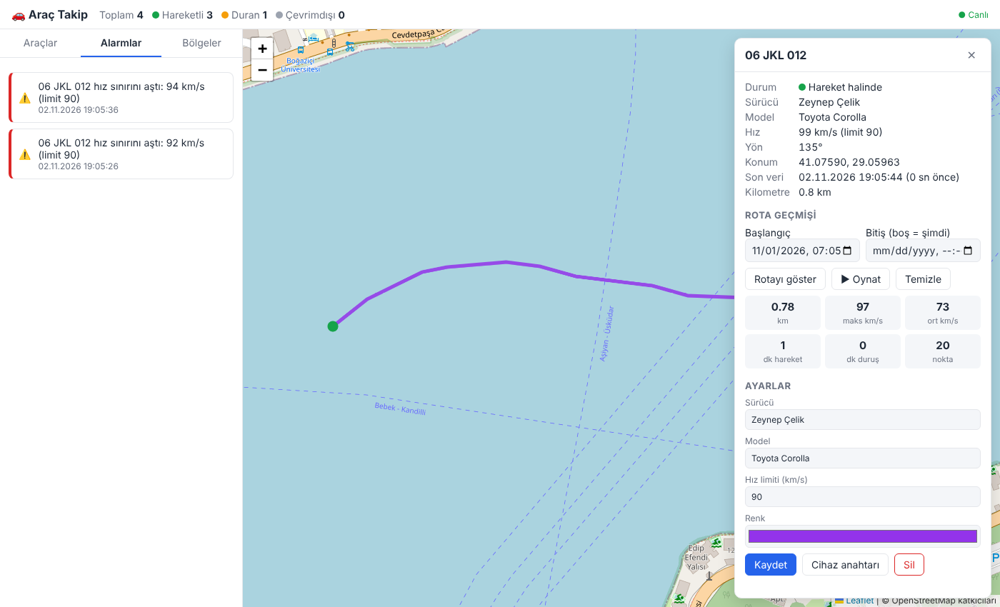

# 🚗 Araç Takip

Araçlar için gerçek zamanlı GPS takip yazılımı. Harici bağımlılık yoktur, yalnızca **Node.js 18+** gerekir.



## Özellikler

- **Canlı harita**: araçların konumu, yönü ve hızı anlık güncellenir (Server-Sent Events)
- **Araç durumu**: hareket halinde / duruyor / çevrimdışı (5 dk veri gelmezse)
- **Rota geçmişi**: tarih aralığına göre rotayı çizme ve **oynatma**
- **İstatistikler**: kat edilen mesafe, maksimum/ortalama hız, hareket ve duruş süreleri, kilometre sayacı
- **Alarmlar**: hız limiti aşımı, bölgeye giriş/çıkış, cihazın tekrar çevrimiçi olması
- **Bölgeler (geofence)**: haritaya tıklayarak dairesel bölge tanımlama
- **Araç yönetimi**: plaka, sürücü, model, hız limiti, renk
- **Cihaz entegrasyonu**: her araca özel cihaz anahtarı; JSON API ve **Traccar Client / OsmAnd** protokolü desteği (telefonu GPS cihazı olarak kullanabilirsiniz)
- Verilerin `data/db.json` dosyasında kalıcı saklanması
- İsteğe bağlı yönetici anahtarıyla panel koruması

## Kurulum ve çalıştırma

```bash
npm start          # http://localhost:3000
npm run demo       # İstanbul'da dolaşan 4 simüle araçla demo
npm test           # testler
```

| Ortam değişkeni | Açıklama | Varsayılan |
|---|---|---|
| `PORT` | Sunucu portu | `3000` |
| `DATA_FILE` | Veri dosyası yolu | `data/db.json` |
| `ADMIN_TOKEN` | Ayarlanırsa panel ve yönetim API'si bu anahtarı ister | (kapalı) |
| `SIMULATE` | `1` ise demo araçları simüle edilir | (kapalı) |

> İnternete açık bir sunucuda mutlaka `ADMIN_TOKEN` ayarlayın ve HTTPS arkasında çalıştırın.

## GPS cihazı / telefon bağlama

Panelde aracı seçip **Cihaz anahtarı** butonuna basın.

**Telefon (Traccar Client uygulaması):**
- Sunucu adresi: `http://SUNUCU:3000/api/osmand`
- Cihaz kimliği: aracın cihaz anahtarı

**Kendi cihazınız / yazılımınız (JSON):**

```bash
curl -X POST http://localhost:3000/api/positions \
  -H "Content-Type: application/json" \
  -H "X-Device-Token: <CIHAZ_ANAHTARI>" \
  -d '{"lat": 41.0082, "lng": 28.9784, "speed": 54, "heading": 90}'
```

`speed` (km/s), `heading` (derece) ve `timestamp` (ms ya da ISO tarih) isteğe bağlıdır; gönderilmezse hız ve yön önceki konuma göre hesaplanır.

## API

`ADMIN_TOKEN` ayarlıysa yönetim uçlarına `Authorization: Bearer <ADMIN_TOKEN>` başlığı eklenmelidir.

| Yöntem | Uç | Açıklama |
|---|---|---|
| GET | `/api/vehicles` | Araç listesi |
| POST | `/api/vehicles` | Araç ekle `{plate, driver, model, speedLimit, color}` |
| GET / PUT / DELETE | `/api/vehicles/:id` | Araç detay / güncelle / sil |
| GET | `/api/vehicles/:id/token` | Cihaz anahtarı |
| POST | `/api/vehicles/:id/positions` | Yönetici olarak konum ekle |
| GET | `/api/vehicles/:id/history?from=&to=` | Konum geçmişi |
| GET | `/api/vehicles/:id/stats?from=&to=` | Aralık istatistikleri |
| GET / POST | `/api/geofences` | Bölge listesi / ekle `{name, lat, lng, radius}` |
| DELETE | `/api/geofences/:id` | Bölge sil |
| GET | `/api/alerts?vehicleId=&limit=` | Alarmlar (yeniden eskiye) |
| GET | `/api/stream` | Canlı olay akışı (SSE) |
| POST | `/api/positions` | Cihaz konum bildirimi (`X-Device-Token`) |
| GET / POST | `/api/osmand` | OsmAnd / Traccar protokolü |

## Proje yapısı

```
src/geo.js        Mesafe, yön ve bölge hesapları
src/tracker.js    Araç, konum, alarm ve bölge mantığı + kalıcılık
src/server.js     HTTP sunucusu, REST API, SSE
src/simulator.js  Demo araç simülatörü
public/           Harita arayüzü (Leaflet + OpenStreetMap)
test/             Testler (node:test)
```
